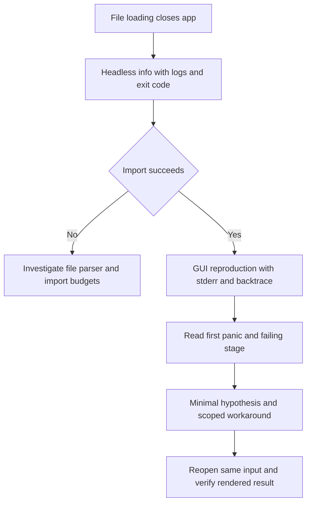
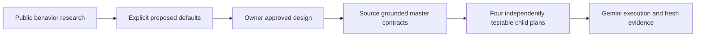

# FigCraft import debugging and plugin handoff

Project-owned; distilled from 2026-10-26. Use for `.fig` loading failures, renderer
diagnosis, screenshot evidence and handing original plugin work to another executor.
Read current source/rules and the indexed topic memory before applying dated details.

## 1. Preserve the owner's working session

Discover current Git changes and running processes. If another executor is active,
claim only memory/playbook files for a knowledge update. Do not edit its source,
reset/stage its changes, launch competing builds, pull shared configuration or
commit its in-progress work. Never treat a plan checkbox or new file as passing
implementation evidence. User-reported Gemini activity is an assignment, not a
request to spawn another agent.

Record dated outcomes with commands/evidence and limits. Do not copy temporary
PIDs, ports, credentials or document contents into durable memory.

## 2. Move a Figma design into FigCraft

1. In Figma, Main menu > File > Save local copy saves a Design `.fig` file.
2. Open or drop it into FigCraft and review import warnings.
3. Check missing fonts and important frames; save a separate native `.figcraft`.

This path is best effort. Comments/version history are excluded from Figma's local
copy; importing editable layers does not establish perfect rendering fidelity.
Figma plugin executables are not carried over as runnable FigCraft plugins.

## 3. Separate parser, layout and rendering failures

Get the precise symptom and owner-provided input path. Check file size, app exit
and captured error before choosing a fix. A large file is a clue, not proof of OOM.



Example diagnostic invocation; replace the path with the owner's supplied path:

```powershell
$env:RUST_BACKTRACE = '1'
& .\target\debug\figcraft-cli.exe info 'C:\path\design.fig' --no-system-fonts 1> plan/setup/import-info.log 2> plan/setup/import-error.log
$importExit = $LASTEXITCODE
Get-Content plan/setup/import-error.log -Tail 80
Write-Output "Import exit: $importExit"
```

Create the local evidence folder first if missing. CLI info without fonts isolates
parsing; it does not validate canvas layout or rendering. Preserve exit code before
later shell commands. PowerShell can wrap native stderr in NativeCommandError
records even for warnings from a successful process. Read actual message and exit.

Reproduce GUI separately with `RUST_BACKTRACE=1`, targeted RUST_LOG, visible window,
stdout/stderr redirected to a new local log. Read the **start** of the panic and
full stack, not just the log's tail. Monitor process responsiveness and memory;
do not kill every Cargo/app process to diagnose a single failure.

## 4. Known temporary Hard Light workaround

Session evidence isolated a tiny-skia 0.12.0 debug u16 multiplication overflow in
the lowp Hard Light stage, after successful import. The original GUI closed; a
package-only build override allowed the same document to render:

```powershell
$env:Path = "$env:USERPROFILE\.cargo\bin;$env:Path"
cargo --config 'profile.dev.package.tiny-skia.overflow-checks=false' build --locked -p figcraft -j 4
```

Apply only after confirming the same failure signature. Leave FigCraft overflow
checks enabled. Do not edit downloaded dependency source, run cargo update or
commit this as a global profile policy. A normal build can reintroduce the crash.
The override is not a permanent fix, regression test or claim that release/wasm/CI
passes. Cargo commands spawned by xtask do not automatically inherit CLI config
overrides. Refer to the rendering bug ledger for current status.

If a rebuild would replace an executable used by an owner session, preserve its
documents and obtain safe closure or an isolated output/session. Never force-kill
the owner's window for a linker/file-lock workaround.

## 5. Select a free port and capture a usable window

Never guess a fixed control port. A diagnostic launch in this session selected an
occupied port: the GUI opened but the control server failed to bind. That log
entry was introduced by the diagnostic launch, not the original file crash.

```powershell
$portProbe = [System.Net.Sockets.TcpListener]::new([System.Net.IPAddress]::Loopback, 0)
$portProbe.Start()
$controlPort = $portProbe.LocalEndpoint.Port
$portProbe.Stop()
```

Pass `$controlPort` to `--control`. The close-and-bind handoff has a small race;
if bind fails, choose a new free port and identify the right app instance. Avoid
attaching to an unknown service that happened to own an old port.

When Start-Process uses ArgumentList, quote an input filename containing spaces
as one native argument, not as separate words. Start the user-facing app with
WindowStyle Normal because visible launch is authorized; helpers stay hidden.
Validate window handle and Responding after import finishes, not just launch PID.

Send newline-delimited JSON control requests with socket timeouts, parse `ok` and
`lastError`. Use a single-quoted PowerShell here-string piped to `python -` for
multi-line JSON/socket scripts, avoiding quote-heavy `python -c` strings.

The control connection may accept a screenshot before the asynchronous canvas
has finished rendering. Poll UI inspection with bounded waits, then take another
screenshot and **read the PNG**. In this session an early gray canvas was replaced
by a later visibly rendered document. `renderWork` can describe previous work and
remain non-null after quality becomes refined; do not wait forever for null alone.
Use overall timeout, quality/error checks and actual pixels.

User actions can change selection/zoom while diagnostics run. Reinspect state;
do not overwrite their navigation repeatedly to force a predetermined screenshot.
Keep owner-art screenshots in ignored local evidence folders only.

## 6. Research reference plugins without claiming unsupported parity

Prefer creators' public documentation/listings. Distinguish:

| Evidence | Safe conclusion |
|---|---|
| Creator feature description | Advertised capability, with exact-control details still open |
| General nine-slice documentation | Technique semantics, not proof of a particular plugin's implementation |
| Screenshot/menu name | Identity hint, not source behavior or installed FigCraft functionality |
| Synthetic black-box run | Observed behavior for that input/version only |
| Source/manifest availability | Not authorization to copy a third-party product's implementation or assets |

Figma Community fetching was blocked in this session. State that limitation and
avoid filling missing facts with guesses presented as verification. In particular,
Make images fit's creator description did not establish whether it changes layer
size or image-fill mode. The owner approved Fit/Fill **mode changes preserving
layer size** as FigCraft's chosen behavior.

Image tracing is approximate; do not promise that detailed raster sprites become
their original vectors. For game UI, nine-slice is useful for preserving decorative
corners, while grid cleanup can damage intentional pixel offsets if applied broadly.

## 7. Write an implementation handoff another model can execute

Use project plan locations `.cursor/plans/design/` and `.cursor/plans/implement/`,
with dated descriptive filenames. User approved the four-tool design and selected
Gemini; do not restart approval or choose another execution method unprompted.
Current local master: `.cursor/plans/implement/2026-10-26-game-ui-plugin-pack.md`.



The six-document handoff includes design, master and four child plans. Check
`git check-ignore` before assuming a plan will travel with a branch: `plans/`
also ignored `.cursor/plans` here. For another checkout, share all six files or
explicitly stage only those plan paths; never force-add ignored raw evidence.

Make every task specify files, consumed/produced interfaces, exact JSON fields and
defaults, safety limits, failing-test assertions, verification commands and expected
results. Put common contracts in master, not inconsistent copies in four plans.
Include current/target Mermaid flows with safe labels. Self-review links, symbols,
numeric examples, module paths and source assumptions before handing off.

Lessons from this handoff's self-review:

- Panel schema is in `crates/plugin/src/manifest.rs`; checkbox JSON type is boolean.
- Plugin milestone is M11, not multiplayer M9.
- Runtime tests must load real built WASM/manifests and exercise panel events;
  mocked/WAT tests alone do not prove the Rust plugin package works.
- Opening a panel or changing a setting must not mutate the document; Apply uses
  current selection, with one undo step. Test that selection changed since opening.
- Algorithms belong behind engine commands; do not increase WASM memory limits
  to shuttle huge image buffers into a plugin.
- Nine-slice crop composition order and transparent Fit margins need pixel tests.
- An undersized center can collapse to zero before an incremental resize repair;
  generated cell geometry must be rebuilt from validated insets when settling.
- Grid cleanup needs alias-binding checks and final normalized-state tests.
- Large trace inputs need decoder limits before allocation, not only a 512px output cap.

## 8. Record and verify knowledge without disturbing implementation

Append dated session outcomes; keep bug lifecycle authority in the domain bug
collection and reusable procedures here. Register each new top-level `mem-*.md`
exactly once in the canonical index; register bug domains in bugs/README.md and
this playbook in playbooks/README.md. Keep shared-owned policy/tools unchanged.

```powershell
node .claude/tools/ai-audit/validate-bug-memory.js --project .
node .claude/tools/ai-audit/check-ai-index.js --project .
'{}' | node .claude/hooks/memory-index-injector.js
git diff --check
```

Read actual hook output and confirm new HUB rows appear within its 3,000-character
budget. An index checker with no findings does not alone prove discovery. Add
current validation outcomes only after commands finish successfully. These checks
validate documentation/discovery, not Gemini's implementation or the app itself.
Do not run shared pull/registry regeneration during another executor's work unless
needed and coordinated; a new row in an existing memory/playbook index does not
require replacing synchronized project configuration. Do not commit an active
executor's unrelated source edits as part of a knowledge-only update.
